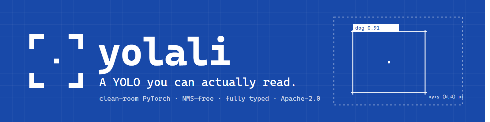
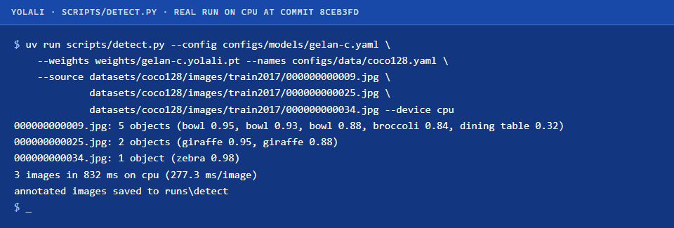
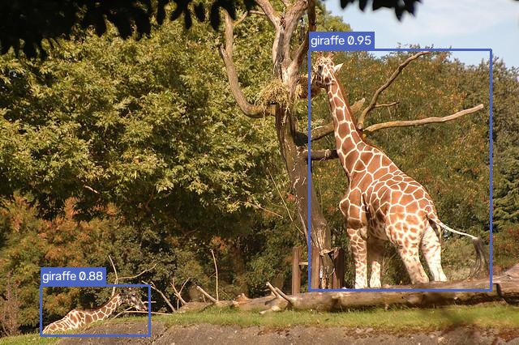

<p align="center">
  
</p>

# yolali

**A YOLO you can actually read.**

A clean-room PyTorch object detection library targeting the 2026 state of the
art: NMS-free end-to-end inference by default, optional DFL, pluggable GELAN
and DINOv2/DINOv3 backbones, and a loss that is decoupled from the model.
Every component is a plain `nn.Module` or a typed dataclass, fully annotated,
tested against hand-computed values, and small enough to understand in one
sitting.

Documentation: **[fzn0x.github.io/yolali](https://fzn0x.github.io/yolali/)**
(datasheet, quickstart, one page per component, API reference, design,
benchmarks).

> **Status: pre-alpha, 0.0.1.** The library, trainer, evaluator, inference
> and export APIs are implemented and tested (167 CPU unit tests). Numbers
> below are the ones that have actually been measured; the remaining
> verification gates in [`docs/plan.md`](docs/plan.md) are running and land
> in [`BENCHMARKS.md`](BENCHMARKS.md) as they finish.

## Why another YOLO

The official reference implementations are research code. They work, but
reading them to learn *how* a modern detector is assembled is a multi-day
effort. yolali is a library, not a framework: no global state, no
monkey-patching, no `sys.argv` parsing anywhere under `src/`. You import
the pieces you want and swap the ones you don't.

## 30-second quickstart

```bash
git clone https://github.com/fzn0x/yolali && cd yolali
uv sync --all-extras
uv run pytest                     # CPU, under a minute
```

```python
from yolali import Detector, load_model

model = load_model("configs/models/gelan-c.yaml", weights="weights/gelan-c.yolali.pt")
det = Detector(model, device="auto")          # cuda, mps or cpu

for r in det.predict(["dog.jpg", "street.jpg"], conf=0.25):   # one Detections per image
    print(r.xyxy, r.conf, r.cls)              # (N, 4) float32 px, (N,) float32, (N,) int64

model.export("onnx", "gelan-c.onnx")          # standard ops only
```

The same from the command line, on three COCO128 images with the converted
official GELAN-C weights (a real run; see [Pretrained weights](#pretrained-weights-and-licenses)
for how to get them):

<p align="center">
  
</p>

<p align="center">
  
</p>

Training, evaluation and export have the same shape:

```bash
uv run scripts/download_datasets.py coco128
uv run scripts/train.py  --model configs/models/gelan-n.yaml --data configs/data/coco128.yaml \
                         --epochs 50 --batch-size 16 --out runs/coco128
uv run scripts/val.py    --config configs/models/gelan-n.yaml --weights runs/coco128/best.pt \
                         --images datasets/coco128/images/train2017 --no-nms
uv run scripts/export.py --config configs/models/gelan-n.yaml --weights runs/coco128/best.pt \
                         --format onnx --out gelan-n.onnx
```

## What "current" means here

| Requirement | Approach |
|---|---|
| NMS-free inference | One-to-many + one-to-one dual label assignment during training (YOLOv10 style); the one-to-one head serves inference with no NMS. A classic head + NMS path stays behind a config flag. |
| DFL optional | Both DFL (YOLOv8/v9 style) and direct `ltrb` regression (YOLO26 style). The direct head exports to ONNX with standard ops only. |
| Pluggable backbones | GELAN CNN (YOLOv9 lineage) and a DINOv2/DINOv3 small ViT with a Spatial Tuning Adapter (DEIMv2 style). Both emit `list[Tensor]` at strides 8, 16, 32. |
| Decoupled loss | `LossConfig` dataclass: task-aligned assigner, CIoU/GIoU, BCE or varifocal, optional DFL, one-to-one loss. |
| Verifiably correct | Weight converter + forward-pass equivalence test against official GELAN-C checkpoints; COCO val2017 mAP reproduced through our own evaluator before any training. |

## Measured so far

Every number has its command, commit, hardware and wall-clock time in
[`BENCHMARKS.md`](BENCHMARKS.md). Nothing is quoted from a paper.

| Check | Result |
|---|---|
| Forward pass of converted `gelan-c.pt` vs the reference code, 640×640 | max abs diff 8.1e-05 on raw head outputs |
| COCO val2017 mAP50-95, converted GELAN-C, our evaluator | **52.5** (published: 52.3) |
| Our evaluator vs pycocotools | agree to 1e-6 on every summary number |
| COCO128 from scratch, `gelan-n-nms`, 50 epochs | smoothed loss monotone decreasing; mAP50 0.069 |
| ONNX Runtime vs PyTorch, dual direct-regression head | parity `< 1e-4` |

Pending: VOC 30-epoch runs for the NMS head, the NMS-free head and the ViT-S
backbone (gates 4b, 6 and the phase-6 gate in `docs/plan.md`).

## Layout

```
src/yolali/
  ops/      boxes, IoU family, anchors, decoding, NMS
  assign/   TaskAlignedAssigner (o2m), OneToOneAssigner (o2o)
  loss/     LossConfig, DetectionLoss, DualLoss, terms
  nn/       blocks, GELAN backbone, GELAN-PAN neck, DFL / direct / dual heads, ViT + STA
  data/     YOLO txt + COCO json readers, label cache, transforms, dataset, collate
  train/    TrainConfig, Trainer, EMA, schedule, checkpoint, loggers
  eval/     COCO-protocol matching, AP, Evaluator
  infer/    Detector, Detections, preprocessing, drawing
  export/   ONNX, TorchScript
  zoo/      official-checkpoint unpickler and converter
configs/    models/*.yaml, data/*.yaml
scripts/    train, val, detect, export, convert_yolov9, download_datasets
docs/       MkDocs site: datasheet, components, API, design, plan, benchmarks
```

## Pretrained weights and licenses

yolali's code is **Apache-2.0**. The GELAN weights our converter can read are
published by WongKinYiu in the [YOLOv9 repository](https://github.com/WongKinYiu/yolov9)
and carry **its GPL-3.0 license**. They are never bundled here; you download
them yourself and the converter re-keys them into our module layout:

```bash
curl -L -o weights/gelan-c.pt https://github.com/WongKinYiu/yolov9/releases/download/v0.1/gelan-c.pt
uv run scripts/convert_yolov9.py weights/gelan-c.pt weights/gelan-c.yolali.pt
```

DINOv2 weights (Apache-2.0) are fetched through `timm` on first use; DINOv3
(Meta DINOv3 license) is opt-in by model name. Details in
[docs/weights.md](docs/weights.md).

## Acknowledgements

The primary architectural inspiration for this library is the work of
**Chien-Yao Wang (WongKinYiu)** and collaborators on
[YOLOv9](https://arxiv.org/abs/2402.13616): the GELAN backbone and neck,
and Programmable Gradient Information. Module docstrings that reimplement
his ideas cite the paper and repository.

Ideas adopted from other authors, with thanks:

- **YOLOv10** (Wang et al., [arXiv:2405.14458](https://arxiv.org/abs/2405.14458)):
  consistent dual label assignment for NMS-free detection.
- **YOLO26** (Ultralytics release notes): removing DFL in favour of direct
  box regression for simpler, op-free export.
- **D-FINE** (Peng et al., [arXiv:2410.13842](https://arxiv.org/abs/2410.13842))
  and **DEIMv2** (Huang et al., [arXiv:2509.20787](https://arxiv.org/abs/2509.20787)):
  the Spatial Tuning Adapter that turns single-scale ViT features into a pyramid.
- **RF-DETR** (Roboflow, [roboflow/rf-detr](https://github.com/roboflow/rf-detr)):
  a clean reference for a DINOv2-backbone real-time detector.

Everything here is written from scratch. No code was taken from AGPL or GPL
repositories; see `NOTICE`.

## License

Apache-2.0. See [`LICENSE`](LICENSE) and [`NOTICE`](NOTICE).
