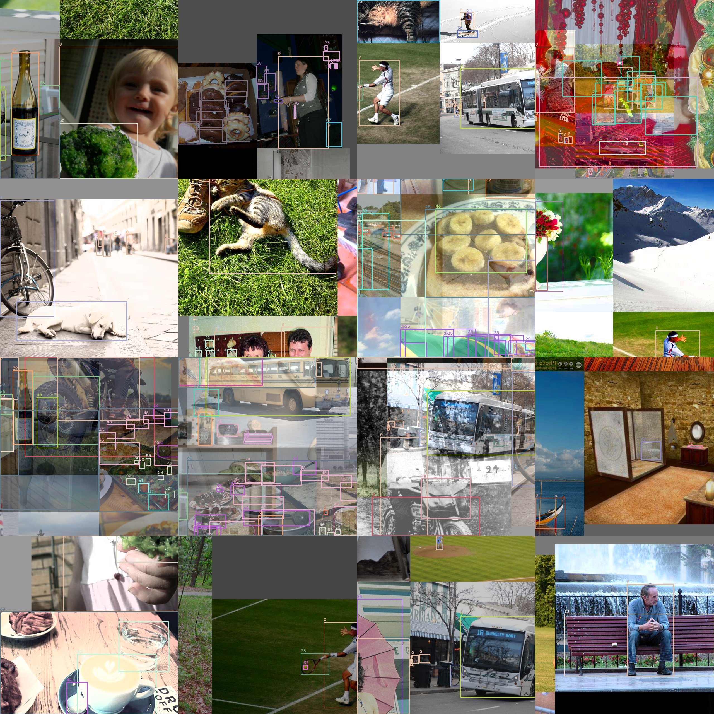

# Data pipeline

## Records and cache

`read_yolo_txt(images_dir)` and `read_coco_json(json, images_dir)` return
`list[LabelRecord]` (path, size, `xyxy` pixel boxes, classes, crowd flags)
without decoding a single pixel; sizes come from image headers. `LabelCache`
stores that list next to the data, keyed by a SHA-1 over every file's path,
size and mtime plus a reader version; any change rebuilds it.

## Samples and transforms

A `Sample` is a numpy object a reader can print: `(H, W, 3)` uint8 RGB,
`(N, 4)` float32 boxes, `(N,)` classes, plus the letterbox bookkeeping
(`orig_hw`, `scale`, `pad`) needed to undo it.

Transforms are callables `(Sample, np.random.Generator) -> Sample`
composed with `Compose`. Every random draw comes from the generator
argument; the dataset derives one generator per `(seed, epoch, index)`, so a
sample is reproducible and two workers never share state. Two transforms
need other images (`Mosaic`, `MixUp`); they receive a sampler callable at
construction, so the dataset stays a plain `__getitem__`.

| Transform | What it does |
|---|---|
| `Letterbox(size, auto, stride)` | resize keeping aspect, pad with gray; records scale and pad, composable with an earlier letterbox |
| `Mosaic(size, sampler)` | four images on a `2s×2s` canvas meeting at a random centre |
| `RandomPerspective(...)` | rotation, translation, scale, shear, perspective; boxes become the bounding box of their warped corners and tiny or degenerate ones are dropped; `border=(-s/2, -s/2)` crops the mosaic back to `s×s` |
| `MixUp(sampler, p)` | blend with a partner of the same size, `Beta(32, 32)` |
| `RandomHSV(h, s, v)` | gains applied through lookup tables, hue wraps |
| `RandomFlip(p, horizontal)` | mirror image and boxes |

`default_train_transforms` is Mosaic → RandomPerspective → Letterbox →
MixUp → HSV → flips; `default_val_transforms` is Letterbox only.

## Batches

`collate_samples` stacks equally sized samples into a `Batch`: `(B, 3, H, W)`
float images in `[0, 1]`, `Targets` (padded boxes, classes, mask), paths
and the per-image letterbox metadata. `RectBatchSampler` sorts images by
aspect ratio and computes one `(H, W)` per batch so validation pads to a
tight rectangle instead of a square; the dataset applies it through
`rect_shapes` after the transform pipeline.

A rendered batch from COCO128, with mosaic, mixup, HSV and flips, is in
`docs/img/coco128_mosaic_batch.jpg` (from `scripts/debug_batch.py`).

Source: `src/yolali/data/`. API: [yolali.data](../api/data.md).
