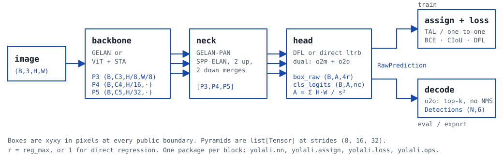

# yolali

<div class="yl-part-header" markdown>
<span>part <b>yolali</b></span>
<span>rev <b>0.0.1</b></span>
<span><span class="yl-stamp">pre-alpha</span></span>
<span>license <b>Apache-2.0</b> (code)</span>
<span>source <a href="https://github.com/fzn0x/yolali">github.com/fzn0x/yolali</a></span>
</div>

**A YOLO you can actually read.** A clean-room PyTorch object detection
library: NMS-free end-to-end inference by default, optional DFL, GELAN and
DINOv2/DINOv3 backbones behind one interface, and a loss decoupled from the
model. Every component is a plain `nn.Module` or a typed dataclass, fully
annotated, tested against hand-computed values, and small enough to read in
one sitting.

## 1. Features

<div class="yl-grid-2" markdown>
<div markdown>

- **NMS-free inference.** Dual one-to-many / one-to-one label assignment
  during training; the one-to-one head serves inference with no NMS.
  A classic head + NMS path stays behind a config flag.
- **DFL optional.** Distribution Focal Loss bins (YOLOv8/v9 style) or direct
  `ltrb` regression (YOLO26 style). The direct head exports to ONNX with
  standard ops only.
- **Two backbones, one interface.** GELAN CNN (YOLOv9 lineage) and a
  DINOv2/DINOv3 ViT with a Spatial Tuning Adapter. Both emit `[P3, P4, P5]`
  at strides 8, 16, 32.
- **Decoupled loss.** `LossConfig` picks the assigner, IoU term, class term
  and DFL independently of the network.

</div>
<div markdown>

- **Verified before trained.** The converted official GELAN-C checkpoint
  reproduces the reference forward pass to `< 1e-4` and the published COCO
  mAP through our own evaluator, which matches pycocotools to `1e-6`.
- **Readable training loop.** `Trainer` is one file: AMP, EMA, warmup +
  cosine, close-mosaic, accumulation, multi-scale, DDP, bitwise resume.
- **Typed end to end.** `pyright --strict` on the whole package; every
  docstring states tensor shapes.
- **Honest numbers.** Nothing in these docs is quoted from a paper. Each
  number carries its command, commit and hardware in [Benchmarks](benchmarks.md).

</div>
</div>

## 2. Block diagram



Each block is one package with one page under [Components](components/index.md):
[ops](components/ops.md), [assign](components/assign.md),
[loss](components/loss.md), [model](components/model.md),
[data](components/data.md), [train](components/train.md),
[eval](components/eval.md), [inference and export](components/infer-export.md).

## 3. Key characteristics

Measured on `dev-3060` (RTX 3060 12 GB, Windows 11, Python 3.12, torch
2.11 + cu128) unless stated. Full records, including the exact commands, are
in [Benchmarks](benchmarks.md). Status marks: `■` measured, `□` pending.

| Characteristic | Condition | Value | Status |
|---|---|---:|:-:|
| Forward-pass equivalence, `gelan-c.pt` | 640×640, fp32, CPU, raw head outputs | max abs diff 8.1e-05 | ■ |
| Forward-pass equivalence, `yolov9-c-converted.pt` | 640×640, fp32, CPU, raw head outputs | max abs diff 2.9e-05 | ■ |
| COCO val2017 mAP50-95, converted GELAN-C | letterbox 640, conf 0.001, NMS IoU 0.7, fp16 | 52.5 (published 52.3) | ■ |
| COCO val2017 mAP50, converted GELAN-C | as above | 69.5 | ■ |
| Evaluator vs pycocotools | every summary number, unit test | agree to 1e-6 | ■ |
| COCO128 from scratch, `gelan-n-nms`, 50 epochs | loss smoothed over 5 epochs | monotone decreasing; mAP50 0.069 | ■ |
| VOC mAP50, `gelan-n-nms`, 30 epochs | NMS head | — | □ |
| VOC mAP50, `gelan-n`, 30 epochs | NMS-free dual head | — | □ |
| VOC mAP50, `vit-s`, 30 epochs | DINOv2 ViT-S + STA, NMS-free | — | □ |
| ONNX Runtime vs PyTorch parity | dual direct-regression head, unit test | `< 1e-4` | ■ |

### Model table

Parameter counts are `sum(p.numel() for p in model.parameters())` on a
model built from the YAML with `nc: 80` (commit `80c0069`). The GELAN-C
count matches the official checkpoint less the 16-value DFL `arange` that
yolali computes instead of storing.

| Config | Backbone | Head | Params | Backbone | Neck | Head |
|---|---|---|---:|---:|---:|---:|
| `gelan-n` | GELAN w0.25 d0.33 | dual, direct | 3,049,832 | 524,976 | 731,072 | 1,793,784 |
| `gelan-n-nms` | GELAN w0.25 d0.33 | DFL + NMS | 2,315,552 | 524,976 | 731,072 | 1,059,504 |
| `gelan-s` | GELAN w0.5 d0.33 | dual, direct | 7,848,920 | 2,088,032 | 2,911,104 | 2,849,784 |
| `gelan-m` | GELAN w0.75 d0.67 | dual, direct | 17,591,112 | 4,689,168 | 6,540,096 | 6,361,848 |
| `gelan-c` | GELAN w1.0 d1.0 | DFL + NMS | 25,498,736 | 8,328,384 | 11,618,048 | 5,552,304 |
| `vit-s` | DINOv2 ViT-S/16 + STA | dual, direct | 31,664,248 | 25,903,360 | 2,911,104 | 2,849,784 |

## 4. Ordering information

```bash
git clone https://github.com/fzn0x/yolali && cd yolali
uv sync --all-extras
uv run pytest
```

yolali is not on PyPI yet; `uv add yolali` will work once `0.1.0` is cut.
The [Quickstart](quickstart.md) runs a converted official model, trains on
COCO128 and exports without NMS in ten minutes.

| Surface | Where |
|---|---|
| Python API | `from yolali import Detector, load_model, build_model, Trainer, TrainConfig` |
| Model configs | `configs/models/*.yaml` (table above) |
| Data configs | `configs/data/coco128.yaml`, `configs/data/voc.yaml` |
| CLIs | `scripts/train.py`, `val.py`, `detect.py`, `export.py`, `convert_yolov9.py`, `download_datasets.py` |
| Pretrained weights | none bundled; see [Weights and licenses](weights.md) |

## 5. Credits

The primary architectural inspiration is the work of **Chien-Yao Wang
(WongKinYiu)** and collaborators on YOLOv9 (GELAN, PGI). Ideas are also
adopted, with thanks, from the YOLOv10, YOLO26, D-FINE, DEIMv2 and RF-DETR
authors; the [Design](design.md) document records what and why. Everything
here is written from scratch; no code was taken from AGPL or GPL repositories.
